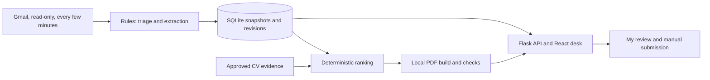

# Inbound

I built this for me. Scout is my Inbound agent: it triages my inbox, prepares
evidence-backed CV packs, asks for decisions and shows what it learned from them.
I review each pack and submit it myself.

**Live demo: https://inbound-scout.vercel.app** (a read-only replay of fictional data: a
made-up applicant's mail, college tasks, memories and CV packs. Nothing in it can be
changed, and it is not connected to any mailbox.) My own desk runs locally on my real
inbox; that data never leaves my PC.

Internship calls arrive as forwarded emails, reminders, inline job descriptions,
and attachments. Inbound groups revisions, shows deadlines and unknowns, and
matches role requirements to my approved project evidence. Scout shows the source
for each fact, what evidence is missing, and which decisions need me.

It never sends mail, fills forms, or submits applications. "Submitted by me" only
records an action I took. Private mail never leaves the PC. No cloud model runs on
private data. Mail arrives live from Gmail through a read-only connection I switch
on myself; nothing else in Inbound uses the network, and no model runs on my mail.

## Architecture

- Gmail sync (read-only scope) checks for new mail every few minutes, saves each
  message and its attachments under my private data folder, and runs the import.
  Local text exports and EML folders also work. Imports publish a snapshot only after
  triage, extraction, and source indexing finish.
- Rules classify mail and extract fields. Fields retain source quotes and an
  explicit found, inferred, unknown, or conflicting status. Reminders add revisions.
- An approved evidence registry supplies CV claims. Deterministic ranking selects
  project bullets and exposes gaps. Email text cannot supply new CV claims.
- Local Tectonic renders the PDF. Checks cover layout, identity, approved skills,
  and bullet provenance. Unreadable job descriptions produce provisional previews
  that need acknowledgement before review.
- Flask serves a loopback API and the React/TypeScript desk. A persistent Pause
  control stops imports, extraction, and pack work. A ledger records local runs.
- The append-only journal streams Scout's work to the desk, with a change-token
  fallback every 10 seconds. Views refresh in place. New calls with a readable JD
  get a draft pack automatically
  (marked for review, never reviewed or sent), and optional browser notifications on
  this PC flag a new PS call or a deadline within 12 hours I have not acted on.

## Using the desk

| Page | What I use it for |
|---|---|
| **Desk** | Scout's current state, a source-linked briefing, next decisions, the command bar and live activity. |
| **Work** | College tasks, mail filters and corrections, call revisions, packs and my own application actions. Past deadlines stay accessible in a collapsed group. |
| **Memory** | Inspect remembered context and its origin, manage local memories, and review each learned rule's scope, examples, recent uses and Undo. |
| **Settings** | Pause, Gmail checks, notifications, theme, privacy and technical runs. |

Scout's expression reflects actual work, connection health or a needed decision.
It does not simulate thinking. Opening the desk reads the saved snapshot; it does
not check Gmail. **Check now** uses the existing guarded read-only check.

The **Daily briefing** covers stored deadlines today/tomorrow, college tasks,
follow-ups, changed calls, waiting drafts and unresolved decisions. Scout saves it
on opening and when the Dubai day or stored facts change. Unchanged reads reuse
the saved version. **Replay briefing** opens the original facts and source excerpts;
the journal and “What did you do today?” link to that saved version. While paused
or in read-only replay, the desk shows a preview without saving new work.

Academic mail can become a **Task** with its stated course, deadline, source quote
and revision history. Date-only deadlines keep their precision; unknown or competing
dates stay visible. Seating plans do not create tasks. **Done**, **Snooze** and
**Not mine** record my choices and support Undo. Scout never marks work done itself.
Opt-in browser alerts also cover supported timed college deadlines within 12 hours;
there is no LMS login, automatic submission or external delivery.

`python -m inbound briefing` prints the same local briefing in UTF-8. Configure
`INBOUND_DATA_ROOT` as for the other CLI commands.

The journal distinguishes in-progress work from committed results. A failed import
keeps its progress and failure record without claiming staged results were published.
Quiet Gmail checks fold together so substantive work remains visible. **Replay last
check** shows a labelled recording of stored events; it does not sync, build, learn
or request notifications. Returning to live activity catches up with the journal.

## Ask Scout

Use **Ask Scout or give a command**, or focus it with **Ctrl/Cmd+K**. **Escape**
closes the conversation and returns focus to work. Supported requests include:

- “What's due this week?” — a stated Dubai date range, open deadlines first,
  passed deadlines last, with date-only and uncertain dates kept explicit.
- “Why is Northstar flagged?” — stored blockers, conflicting facts and rule matches.
- “What assignments are due?” — college tasks ordered by supported deadlines.
  “Mark Assignment 2 done” previews a manual task action with confirmation and Undo.
- “What changed since yesterday?” or “What did you do today?” — committed recorded
  work, with repeated quiet checks folded and times shown in Dubai.
- “Find backend roles” or “What do you know about my projects?” — local results
  with approved evidence or versioned memory citations.
- “Skip Northstar because it requires relocation”, “Remember that I prefer remote
  roles”, “Forget my remote preference”, “Check now” and “Pause” — previewed
  commands requiring confirmation, with Undo where supported.

Ambiguous matches show choices. Citations open the original version and identify
newer information. Unsupported requests show supported examples. This is a bounded
local parser, with no cloud fallback or Claude adapter. Questions remain available
while paused; commands retain Pause, CSRF, import and stale-version protections.
Conversation history stays in this browser tab's session storage and can be cleared.

## What stays local

Mail, attachments, SQLite snapshots, the journal, memory and packs live under the
configured data root on this PC. The browser talks to the loopback Flask service;
source bodies load when **View source** opens. Theme and notification choices stay
in browser storage. Recorded replay uses saved synthetic or local events, while the
separate read-only replay mode refuses databases containing private messages.

Gmail is an explicit opt-in network exception for reading mail. No model processes
private mail, and memory cannot enable cloud access, send mail or grant a capability.
The fictional demo and test artifacts use `.local/`; runtime private data is ignored
by Git and is never part of the web build.



## Run the fictional demo

Use the repository root in PowerShell. The supplied environment has Python
libraries, web dependencies, Tectonic, and its offline compilation cache already
provisioned. Dependencies are recorded in [requirements-lock.txt](requirements-lock.txt)
and [web/package-lock.json](web/package-lock.json). The PDF builder's local paths
are in [inbound/packs/build.py](inbound/packs/build.py); another machine needs those
paths and the cached compiler set up first.

```powershell
$env:PATH = "$PWD\.venv\Scripts;$env:PATH"
$env:PYTHONPYCACHEPREFIX = "$PWD\.local\pycache"
npm --prefix web run build
python -m inbound demo
python -m inbound serve
```

Open <http://127.0.0.1:5000>. The demo uses fictional mail and Sara Qamar's fictional
CV evidence. Its clock is frozen to the evaluation snapshot so deadlines remain
reproducible. Start at Desk, follow a decision into Work, inspect its source text and
role coverage, then review the PDF and checks. Memory shows saved context and rules;
Settings shows Pause and the run ledger.

The demo stores its database and pack files under `.local/`. It does not need mail
credentials. For a separate local export, configure `INBOUND_DATA_ROOT` and import
with an explicit provenance:

```powershell
python -m inbound import --source export --path <export-folder> --provenance synthetic
python -m inbound digest
```

Use `--source eml` for EML files. Real local exports require `--provenance private`;
that flag does not enable model access. See [SPEC.md](SPEC.md) for the export format
and [.env.example](.env.example) for local settings. Attachments must be exported
with their bytes and relative file paths. A filename alone cannot provide a JD.

## Connect Gmail (read-only)

Inbound asks Google for one permission, `gmail.readonly`. It can read mail and
attachments; it cannot send, delete, label, or change anything. The code may only
call Google's token endpoint and the Gmail read API, and tests fail if any send or
modify scope or endpoint appears. One-time setup, done by me in my own Google account:

1. In Google Cloud Console, create a project and enable the **Gmail API**.
2. Configure the OAuth consent screen. Choose **Internal** if my Workspace allows it.
   Otherwise choose **External**, leave it in **Testing**, and add my address as a test
   user; Google then expires the sign-in after 7 days, so I reconnect weekly.
3. Create an OAuth client of type **Desktop app** and download its JSON into my private
   data folder (the folder `INBOUND_DATA_ROOT` points to).
4. Connect and switch on live checks:

```powershell
$env:INBOUND_DATA_ROOT = "<private data folder>"
python -m inbound gmail connect --client-secret "$env:INBOUND_DATA_ROOT\client_secret.json"
python -m inbound gmail poll --on --minutes 2
python -m inbound serve          # the desk checks Gmail while it runs
python -m inbound watch          # or: keep checking without the desk open
```

`gmail connect` prints a Google consent link; I open it, approve read-only access, and
the token is saved in `<data folder>\gmail\token.json`, never in the repository. The
first check reads the last 30 days (spam, trash, drafts and my own sent mail are
skipped); later checks ask Gmail only for what changed. Settings / Runs shows the
account, last and next check, and a **Check Gmail now** button. Pause stops checks.
A Workspace administrator can block third-party apps; if so, the connect step fails
with Google's message and the export path above still works.

## Scout's memory

Claude supplies the curated snapshot as UTF-8 Markdown files directly under
`<data_root>/memory/`. Each file has front matter like this fictional example:

```markdown
---
name: Sara's profile
description: Fictional applicant profile
type: user
source: sara-profile
---
Sara studies at Port Selene College.
```

Types are `user`, `feedback`, `project` and `reference`. The optional `source` is a
stable source identity; keep it unchanged across renames. Without it, identity follows
the filename, independently of the title. Metadata must be a flat scalar map.

Open **Memory** to refresh, add, edit, disable or forget a memory. Local additions
and imported-memory edits go under `<data_root>/memory-local/`; the curated files
remain untouched. A changed curated source shows a conflict alongside its local edit.
Forgetting an imported memory persists a suppression, removes it from retrieval and
clears its stored memory-version contents. Historical chats and generated artifacts
may still contain text; journal events retain only typed IDs and counts.

`python -m inbound serve` checks these directories every minute in local mode. Pause
and a running message import defer scans. Page reads and replay mode never scan.
Limits: 128 Markdown files across both roots, 64 KiB per file and 2 MiB total;
directory enumeration is also bounded. Links/junctions are rejected, files are never
read recursively, and malformed or changing snapshots keep the previous valid version.
A previously published directory disappearing is incomplete; an existing empty
directory deliberately removes its entries. Markdown supports headings, lists, links,
code and bold text; HTML and image syntax remain inert text.

Prose memories are remembered context. They cannot override message evidence, approve
skills or become CV evidence. The committed `fixtures/memory/` snapshot contains
fictional test data only.

Category corrections preserve the original classification and human history, then
offer an exact-mailbox rule with a subject condition where needed. Activation affects
future matching mail; reprocessing stored messages is a separate previewed action.
Manual corrections win. A learned category never expands the trusted PS-office sender
list or authorizes opportunity creation.

Explicit supported preferences can affect explained ranking: remote, hybrid, in-person
work and avoiding required relocation. Suggestions have no influence until activated.
Skip reasons remain on the original opportunity; a clear reason can offer a broader
preference for review. Preferences do not hide opportunities or override deadline
priority. Rule versions, example matches and recent uses are visible in Memory.
Undo stops future influence without erasing the original action or rewriting past packs.

## Evaluation

These are synthetic results, not a measurement of accuracy on my inbox. The first
blind run is preserved in [eval/results.json](eval/results.json). The separate
[eval/results-after-fixes.json](eval/results-after-fixes.json) records fixes for
wrapped deadline times and inline numbered roles. After those fixes, held-out data
is no longer blind for those classes. Later interface and import changes do not
rerun or replace either evaluation record.

All counts below come from those committed JSON files. Applicable-field scores
include correctly unknown values. Populated-field scores exclude gold unknowns.

| Metric | First blind run | After fixes |
|---|---:|---:|
| Dev triage messages | 64 | 64 |
| Held-out triage messages | 116 | 116 |
| Dev / held-out triage macro-F1 | 1.0 / 1.0 | 1.0 / 1.0 |
| Dev / held-out PS-call recall | 1.0 / 1.0 | 1.0 / 1.0 |
| Dev applicable fields | 266/266 | 266/266 |
| Dev populated fields | 177/177 | 177/177 |
| Dev full records | 24/24 | 24/24 |
| Dev exact deadlines | 22/22 | 22/22 |
| Dev silently wrong deadlines | 0 | 0 |
| Held-out applicable fields | 365/387 | 368/387 |
| Held-out populated fields | 228/250 | 231/250 |
| Held-out full records | 23/36 | 24/36 |
| Held-out exact deadlines | 31/33 | 32/33 |
| Held-out role titles | 36/39 | 38/39 |
| Held-out requirement associations | 84/95 | 89/95 |
| Held-out abstentions | 154 | 152 |
| Held-out silently wrong deadlines | 1 | 0 |
| Dev admin deadline recall | 2/2 | 2/2 |
| Held-out admin deadline recall | 3/4 | 3/4 |
| Packs built, frozen subset | 8/8 | 8/8 |
| Normal packs passing checks | 6/6 | 6/6 |
| Provisional previews passing checks | 2/2 | 2/2 |
| CV bullets traced to approved evidence | 64/64 | 64/64 |
| Fixed CV requirement support | 18/18 | 18/18 |
| Ranked CV requirement support | 18/18 | 18/18 |
| Forbidden action attempts | 0 | 0 |
| Model comparison | Not run | Not run |

Extraction still misses fields and whole records. An unknown deadline is not proof
that a call is still open. Perfect triage on this dataset does not imply perfect
triage on other mail.

## Limits and build process

Extraction is rules-only. Unfamiliar wording and layouts can fail. Text PDFs and
DOCX paragraphs and tables are supported; scanned attachments need another path.
Missing or unreadable attachments block normal review.

The builders authored the synthetic dataset and its labels. Held-out variants give
some separation, but they are not an independent external benchmark. The ranking
ties the fixed general CV baseline at 18/18 supported requirements. This evaluation
does not establish a ranking improvement. Model comparison was not run.

Claude Code planned the work and verified each milestone. Codex wrote code milestone
by milestone. Claude ran the private-mail pipeline locally and shared sanitized
findings. Codex reproduced those findings with fictional data. Claude reviews and
commits the changes. [SPEC.md](SPEC.md) and [DESIGN.md](DESIGN.md) record the
contract, including the amendments made after each review.
