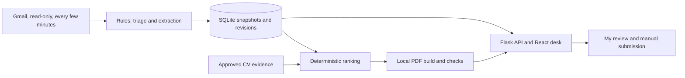

# Inbound

I built this for me. Inbound is a personal agent that triages my inbox and turns
each internship call into an evidence-backed CV pack. I review the pack and submit
it myself.

Internship calls arrive as forwarded emails, reminders, inline job descriptions,
and attachments. Inbound groups revisions, shows deadlines and unknowns, and
matches role requirements to my approved project evidence. The local desk shows
what needs attention, the source for each fact, and what evidence is missing.

It never sends mail, fills forms, or submits applications. "Submitted by me" only
records an action I took. Private mail never leaves the PC. No cloud model runs on
private data. Mail arrives live from Gmail through a read-only connection I switch
on myself; nothing else in Inbound uses the network, and no model runs on my mail.

## Architecture

- Gmail sync (read-only scope) checks for new mail every few minutes, saves each
  message and its attachments under my private data folder, and runs the import.
  Local text exports and EML folders also work. Imports publish a snapshot only after
  triage, extraction, and source indexing finish.
- Rules classify mail and extract fields. Fields retain source quotes and an
  explicit found, inferred, unknown, or conflicting status. Reminders add revisions.
- An approved evidence registry supplies CV claims. Deterministic ranking selects
  project bullets and exposes gaps. Email text cannot supply new CV claims.
- Local Tectonic renders the PDF. Checks cover layout, identity, approved skills,
  and bullet provenance. Unreadable job descriptions produce provisional previews
  that need acknowledgement before review.
- Flask serves a loopback API and the React/TypeScript desk. A persistent Pause
  control stops imports, extraction, and pack work. A ledger records local runs.
- Everything is live: the open desk watches a change token every 10 seconds and
  refreshes in place, new calls with a readable JD get a draft pack automatically
  (marked for review, never reviewed or sent), and optional browser notifications on
  this PC flag a new PS call or a deadline within 12 hours I have not acted on.



## Run the fictional demo

Use the repository root in PowerShell. The supplied environment has Python
libraries, web dependencies, Tectonic, and its offline compilation cache already
provisioned. Dependencies are recorded in [requirements-lock.txt](requirements-lock.txt)
and [web/package-lock.json](web/package-lock.json). The PDF builder's local paths
are in [inbound/packs/build.py](inbound/packs/build.py); another machine needs those
paths and the cached compiler set up first.

```powershell
$env:PATH = "$PWD\.venv\Scripts;$env:PATH"
$env:PYTHONPYCACHEPREFIX = "$PWD\.local\pycache"
npm --prefix web run build
python -m inbound demo
python -m inbound serve
```

Open <http://127.0.0.1:5000>. The demo uses fictional mail and Sara Qamar's fictional
CV evidence. Its clock is frozen to the evaluation snapshot so deadlines remain
reproducible. Start at Today / Inbox, open a call, inspect its source text and role
coverage, then review the PDF and checks. Settings / Runs shows Pause and the ledger.

The demo stores its database and pack files under `.local/`. It does not need mail
credentials. For a separate local export, configure `INBOUND_DATA_ROOT` and import
with an explicit provenance:

```powershell
python -m inbound import --source export --path <export-folder> --provenance synthetic
python -m inbound digest
```

Use `--source eml` for EML files. Real local exports require `--provenance private`;
that flag does not enable model access. See [SPEC.md](SPEC.md) for the export format
and [.env.example](.env.example) for local settings. Attachments must be exported
with their bytes and relative file paths. A filename alone cannot provide a JD.

## Connect Gmail (read-only)

Inbound asks Google for one permission, `gmail.readonly`. It can read mail and
attachments; it cannot send, delete, label, or change anything. The code may only
call Google's token endpoint and the Gmail read API, and tests fail if any send or
modify scope or endpoint appears. One-time setup, done by me in my own Google account:

1. In Google Cloud Console, create a project and enable the **Gmail API**.
2. Configure the OAuth consent screen. Choose **Internal** if my Workspace allows it.
   Otherwise choose **External**, leave it in **Testing**, and add my address as a test
   user; Google then expires the sign-in after 7 days, so I reconnect weekly.
3. Create an OAuth client of type **Desktop app** and download its JSON into my private
   data folder (the folder `INBOUND_DATA_ROOT` points to).
4. Connect and switch on live checks:

```powershell
$env:INBOUND_DATA_ROOT = "<private data folder>"
python -m inbound gmail connect --client-secret "$env:INBOUND_DATA_ROOT\client_secret.json"
python -m inbound gmail poll --on --minutes 2
python -m inbound serve          # the desk checks Gmail while it runs
python -m inbound watch          # or: keep checking without the desk open
```

`gmail connect` prints a Google consent link; I open it, approve read-only access, and
the token is saved in `<data folder>\gmail\token.json`, never in the repository. The
first check reads the last 30 days (spam, trash, drafts and my own sent mail are
skipped); later checks ask Gmail only for what changed. Settings / Runs shows the
account, last and next check, and a **Check Gmail now** button. Pause stops checks.
A Workspace administrator can block third-party apps; if so, the connect step fails
with Google's message and the export path above still works.

## Evaluation

These are synthetic results, not a measurement of accuracy on my inbox. The first
blind run is preserved in [eval/results.json](eval/results.json). The separate
[eval/results-after-fixes.json](eval/results-after-fixes.json) records fixes for
wrapped deadline times and inline numbered roles. After those fixes, held-out data
is no longer blind for those classes. M6 changes presentation and import plumbing;
it does not rerun or replace either evaluation record.

All counts below come from those committed JSON files. Applicable-field scores
include correctly unknown values. Populated-field scores exclude gold unknowns.

| Metric | First blind run | After fixes |
|---|---:|---:|
| Dev triage messages | 64 | 64 |
| Held-out triage messages | 116 | 116 |
| Dev / held-out triage macro-F1 | 1.0 / 1.0 | 1.0 / 1.0 |
| Dev / held-out PS-call recall | 1.0 / 1.0 | 1.0 / 1.0 |
| Dev applicable fields | 266/266 | 266/266 |
| Dev populated fields | 177/177 | 177/177 |
| Dev full records | 24/24 | 24/24 |
| Dev exact deadlines | 22/22 | 22/22 |
| Dev silently wrong deadlines | 0 | 0 |
| Held-out applicable fields | 365/387 | 368/387 |
| Held-out populated fields | 228/250 | 231/250 |
| Held-out full records | 23/36 | 24/36 |
| Held-out exact deadlines | 31/33 | 32/33 |
| Held-out role titles | 36/39 | 38/39 |
| Held-out requirement associations | 84/95 | 89/95 |
| Held-out abstentions | 154 | 152 |
| Held-out silently wrong deadlines | 1 | 0 |
| Dev admin deadline recall | 2/2 | 2/2 |
| Held-out admin deadline recall | 3/4 | 3/4 |
| Packs built, frozen subset | 8/8 | 8/8 |
| Normal packs passing checks | 6/6 | 6/6 |
| Provisional previews passing checks | 2/2 | 2/2 |
| CV bullets traced to approved evidence | 64/64 | 64/64 |
| Fixed CV requirement support | 18/18 | 18/18 |
| Ranked CV requirement support | 18/18 | 18/18 |
| Forbidden action attempts | 0 | 0 |
| Model comparison | Not run | Not run |

Extraction still misses fields and whole records. An unknown deadline is not proof
that a call is still open. Perfect triage on this dataset does not imply perfect
triage on other mail.

## Limits and build process

Extraction is rules-only. Unfamiliar wording and layouts can fail. Text PDFs and
DOCX paragraphs and tables are supported; scanned attachments need another path.
Missing or unreadable attachments block normal review.

The builders authored the synthetic dataset and its labels. Held-out variants give
some separation, but they are not an independent external benchmark. The ranking
ties the fixed general CV baseline at 18/18 supported requirements. This evaluation
does not establish a ranking improvement. Model comparison was not run.

Claude Code planned the work and verified each milestone. Codex wrote code milestone
by milestone. Claude ran the private-mail pipeline locally and shared sanitized
findings. Codex reproduced those findings with fictional data. Claude reviews and
commits the changes. [SPEC.md](SPEC.md) and [DESIGN.md](DESIGN.md) record the
contract, including the amendments made after each review.
